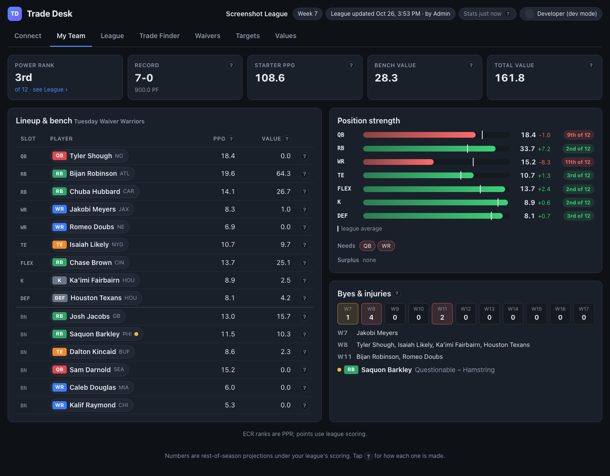
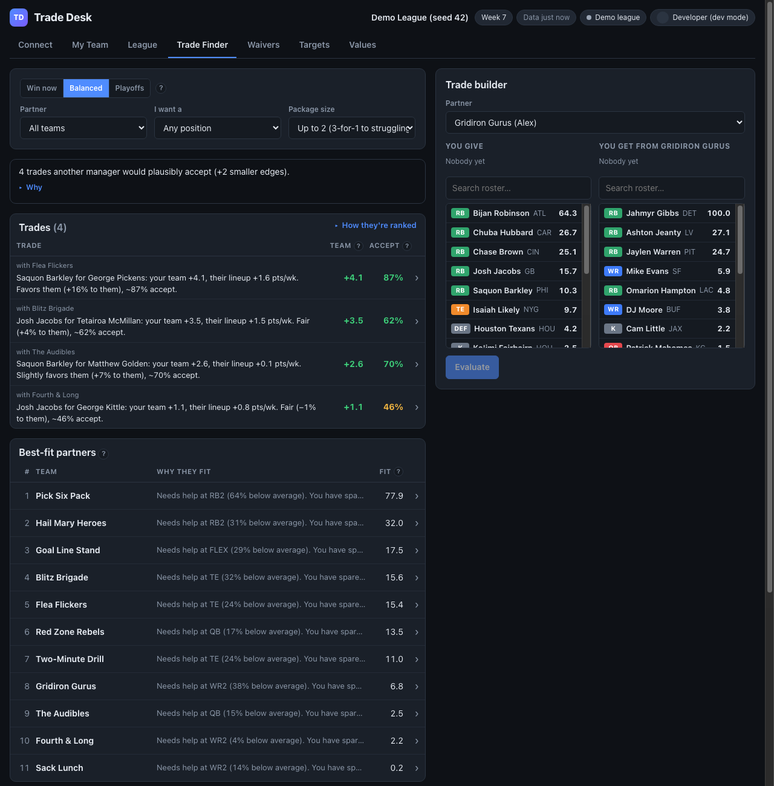

# Fantasy Trade Desk

A local web app that connects to your **Yahoo Fantasy Football** league, models
every player's rest-of-season value under *your league's* scoring and lineup
rules, and tells you which trades to propose, which free agents to pick up, and
whether a pickup is worth spending your waiver priority.

Everything runs on your machine. The only outbound calls are to Yahoo (your
league) and to public GitHub-hosted data files (player stats and rankings).
Nothing is written back to Yahoo; the app is read-only.



## Quick start

Requires Node 22+.

```bash
git clone <this repo> && cd FantasyFootball
npm install
cp .env.example .env        # fill in Yahoo credentials (see below) or skip for the demo
npm run dev                 # server on :3000, UI on http://localhost:5173
```

Production build (single server on http://localhost:3000):

```bash
npm run build && npm start
```

The first start downloads roughly 30 MB of player data into `.cache/` and takes
a minute. Later starts are instant; files refresh automatically after a few hours.

Click **Use demo league** on the Connect tab to explore with a realistic
12-team league drafted from current rankings. To use your own league, follow
[docs/YAHOO_SETUP.md](docs/YAHOO_SETUP.md) (about five minutes: create a free
Yahoo developer app, paste two values into `.env`, approve read access once).
Waiting for Yahoo to approve your API app? Use **Import from Yahoo (browser)**:
a bookmark copies your league from Yahoo's web pages and you paste it into
Trade Desk. See [docs/IMPORT.md](docs/IMPORT.md).

## What it does

| Tab | What you get |
|---|---|
| **Connect** | Yahoo login, league and team picker, the demo league, or import from Yahoo's web pages ([docs/IMPORT.md](docs/IMPORT.md)). |
| **My Team** | Optimal lineup, position-by-position strength ranked against the league, needs and surplus, bye and injury exposure. Tap Power rank to open the League tab. |
| **League** | Power rankings as a chart (0.7 × projected starter points + 0.3 × actual points per game; bench depth only breaks ties), the standings table, and for every team above you a one-line why: projected starter points, actual points per game and the position groups where they beat you, with a mini chart on tap. |
| **Trade Finder** | Packages priced the way the other manager sees them (market values), kept only when your roster improves by our projections *and* the other side would plausibly accept; buy-low / sell-high and market-gap tags, bench upgrades, and a builder to evaluate any offer. |
| **Waivers** | Free agents ranked by how much they improve your lineup versus your most droppable player, with trend and injury flags, and a claim / optional / stash / wait / pass call that accounts for your rolling-list priority (or FAAB). Claims include future starters (rising role, path open, flex-level opportunity); injured players are never worth priority sight unseen. |
| **Values** | Every player's projection, value, luck (expected minus actual points: + = due for more), actual vs expected production, and owner, sortable and searchable. |



## How values are computed

There is one valuation (projection v4), used by every tab. For each player and
each remaining week: points = rate × matchup × availability. The rate is his
*expected* fantasy points from recent usage (targets, air yards, carries; the
latest games weigh most and games with a backup QB, an early exit or a blowout
count less) times how well he converts it, pulled toward average so touchdown
spikes regress, with the FantasyPros expert rank as a light sanity check. The
matchup is what his opponent allows to his position, plus a small bonus from
the next game's Vegas total. Byes and injuries set weeks to 0. Value is the
surplus over a replacement-level player for your league, with the playoff weeks
counting most when your team holds a playoff spot, on a convex scale so one star
is worth more than two mid-tier players. Every number in the UI has a **?**
tooltip that explains how it was made.

## Data sources

All free and keyless, refreshed automatically by their maintainers:

* [nflverse](https://github.com/nflverse/nflverse-data): rosters, schedule and byes, injury reports, snap counts.
* [ffopportunity](https://github.com/ffverse/ffopportunity): weekly actual and expected fantasy production.
* [DynastyProcess](https://github.com/dynastyprocess/data): FantasyPros expert consensus rankings and weekly projections, cross-platform player IDs, dynasty values.

## Scripts

| Command | Purpose |
|---|---|
| `npm run dev` | Server with reload on :3000 plus Vite UI on :5173 |
| `npm run build` / `npm start` | Build the UI, serve everything from :3000 |
| `npm test` | Unit and integration tests (engine, Yahoo parsers, API) |
| `npm run typecheck` | Strict TypeScript for server and web |

## Sign-in (hosted)

A hosted server signs people in with Discord (scope `identify`). Production refuses to start without
`DISCORD_CLIENT_ID`, `DISCORD_CLIENT_SECRET`, `SESSION_SECRET` (≥ 32 random characters, e.g. `openssl rand -hex 32`) and
`PUBLIC_URL` (the site's address; the Discord redirect URI is `PUBLIC_URL/auth/callback`). Who may sign in is
`.data/access.json` (never committed): `{ "admins": ["<discord id>"], "users": [{ "discordId": "…", "leagueId": "y1405188",
"teamId": "4", "note": "…" }] }`. Admins see everything and can "View as" a user; a user sees only their team in their
league and may re-import it. Missing file = nobody can sign in. Without Discord config, `npm run dev` runs in dev mode
(you are the admin). Details: docs/DESIGN.md "Discord sign-in, multi-tenant".

## Troubleshooting

* **Yahoo returns 403 "not authorized" on everything**: since July 2026 Yahoo requires app approval for the Fantasy API. See the top of [docs/YAHOO_SETUP.md](docs/YAHOO_SETUP.md).

* **Stale numbers**: delete `.cache/` to force a data refresh.
* **Yahoo says reconnect / 401**: delete `.data/yahoo-tokens.json` and connect again.
* **Yahoo 999**: rate limited; wait a few minutes. The app caches league imports for 15 minutes to avoid this.
* **A player shows as unmatched**: the app maps Yahoo players by ID, then by name, position and team. Rookies occasionally lack a Yahoo ID in the public crosswalk; they still match by name.
* **First live Yahoo run**: Yahoo could not be reached from the environment this app was built in, so the integration was written against the documented API and tested on fixtures. If an import fails, the error includes the endpoint and the raw response; see the troubleshooting section of [docs/YAHOO_SETUP.md](docs/YAHOO_SETUP.md).

## Layout

```
server/data        loaders for the public data files, player database
server/model       scoring, signals, projection v4, lineup, analysis, trades, waivers
server/providers   yahoo (OAuth + import), demo
server/api.ts      HTTP API (contract in docs/DESIGN.md)
server/auth        Discord sign-in, sessions, access list, the route guard
web/               React UI
docs/DESIGN.md     design spec and API contract
```
